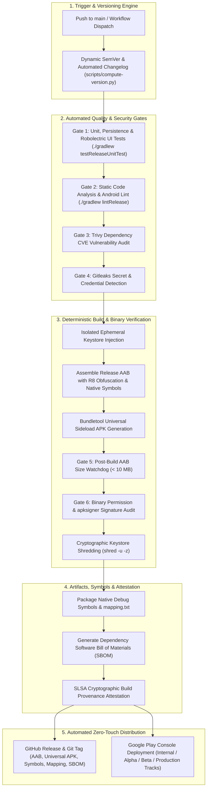

# 📱 Pixelabs Calculator

<div align="center">


<p align="center">
  <b>A modern, privacy-first, offline Android calculator crafted with Jetpack Compose, Material You design, and an enterprise zero-touch CI/CD release pipeline.</b>
</p>

[**Pixelabs Website**](https://pixelabs.in) • [**Legal & Privacy Portal**](https://policies.pixelabs.in/) • [**Features**](#-features) • [**Architecture**](#-architecture--tech-stack) • [**DevOps & CI/CD**](#-enterprise-devops--cicd) • [**Building**](#-building--testing)

</div>

---

## ✨ Features

### 🎨 Material You & Expressive Motion
- **Dynamic Theming**: Adapts seamlessly to System, Dark, and Light themes with Material 3 color harmony.
- **Organic Stadium Oval Keypad**: Smooth horizontal stadium/capsule key geometries engineered for thumb ergonomics.
- **Fluid Spring Animations**: Micro-interactions powered by Compose physics springs and animated elevation.
- **Haptic Feedback**: Tactile vibrations distinguishing light inputs from heavy evaluations (`=`, `AC`).

### 📐 Powerful Scientific Engine
- **Trigonometry**: Sine, Cosine, Tangent, and their inverse functions ($\arcsin$, $\arccos$, $\arctan$).
- **Angle Modes**: Instant toggle between Radians (`RAD`) and Degrees (`DEG`).
- **Advanced Mathematics**: Natural logarithms ($\ln$), common logarithms ($\log$), powers ($x^y$), square roots ($\sqrt{x}$), factorials ($!$), constants ($\pi$, $e$).
- **Smart Expression Parser**: Implicit multiplication (`2(3)`, `2π`), percentage evaluations, and automatic parenthesis balancing.

### 🔄 Adaptive Dual-Orientation Architecture
- **Portrait Experience**: Focused daily calculation keypad with a smooth expandable scientific drawer and history sheet.
- **Ergonomic Landscape Experience**:
  - Dedicated top horizontal display with auto-scrolling expression input and real-time evaluated preview.
  - **3 + 4 Grid Architecture**: 3 columns of scientific functions paired with 4 columns of primary numeric operators.
  - **Collapsible Scientific Panel**: Smoothly toggle between full scientific mode and an expanded basic numeric keypad with fluid width transitions.

### 📜 Calculation History
- Fast local storage persisting past calculations across app sessions.
- Tap any past expression to recall it directly into the active calculation canvas.
- Quick history wipe with haptic confirmation.

### 🔒 Privacy-First Guarantee
- **100% Offline Core**: Zero internet permissions required for standard math calculations.
- **Zero Background Tracking**: No third-party ad networks, no analytics trackers, no telemetry SDKs.
- **Voluntary User Feedback**: User-initiated feedback modal with explicit opt-in consent and optional diagnostic toggles.

---

## 🏗 Architecture & Tech Stack

```
Calculator-
├── app/
│   ├── src/main/java/com/example/
│   │   ├── MainActivity.kt               # Jetpack Compose UI & Adaptive Layouts
│   │   ├── calculator/
│   │   │   ├── CalculatorViewModel.kt    # State management & expression orchestration
│   │   │   └── ExpressionParser.kt       # Deterministic recursive-descent math engine
│   │   └── data/
│   │       └── HistoryEntry.kt           # Local calculation history data model
│   └── src/test/                         # Comprehensive unit & Robolectric test suite
├── scripts/
│   ├── compute-version.py               # Monotonic SemVer calculation engine
│   ├── generate-changelog.py            # Automated Conventional Commit changelog
│   └── bundle_debug_symbols.py          # Native debug symbols & mapping packager
└── .github/workflows/
    ├── deploy.yml                       # Production-grade Release CI/CD workflow
    ├── build-test-apk.yml               # Continuous Integration Debug Build & Test
    └── sync-store-assets.yml            # Fastlane Play Store Assets & Metadata Sync
```

| Layer | Technology |
|---|---|
| **Language** | Kotlin 2.0+ |
| **UI Framework** | Jetpack Compose (BOM 2024.09.00) |
| **Design System** | Material Design 3 (Material You) |
| **Architecture** | MVVM (Model-View-ViewModel) + Single Source of Truth |
| **Asynchronous** | Kotlin Coroutines & `StateFlow` |
| **Testing** | JUnit 4, Robolectric, Roborazzi Screenshot Testing |
| **Build System** | Gradle 8.7 + Android Gradle Plugin 8.5.2 (Configuration Cache enabled) |

---

## 🚀 Enterprise DevOps & CI/CD

This repository features a **zero-touch, production-grade automated release pipeline** configured via GitHub Actions ([`.github/workflows/deploy.yml`](.github/workflows/deploy.yml)):



### Pipeline Architecture & Quality Gates

The production pipeline enforces an enterprise fail-fast architecture across 14 dedicated steps and 6 strict quality gates:

1. **Automated Dynamic Versioning & Changelog**:
   - `versionCode` is monotonically computed from git history and existing release tags (`git tag -l "v*"`).
   - `versionName` dynamically follows Semantic Versioning (`MAJOR.MINOR.PATCH`) deduced from Conventional Commits (`feat` $\to$ minor, `fix` $\to$ patch, `BREAKING CHANGE` $\to$ major).
   - Generates release notes and Google Play `whatsnew` distribution files automatically.

2. **Strict Multi-Layer Quality & Security Gates**:
   - **Quality Gate 1 (Unit, Persistence & UI Tests)**: Executes JVM-based Robolectric UI tests, calculation fuzz testing, Room persistence verification, and mathematical parser test suites (`./gradlew testReleaseUnitTest`).
   - **Quality Gate 2 (Android Lint)**: Enforces code quality, API compliance, and resource integrity (`./gradlew lintRelease`).
   - **Quality Gate 3 (Trivy CVE Audit)**: Scans filesystem and dependencies for critical/high Common Vulnerabilities and Exposures (CVEs).
   - **Quality Gate 4 (Gitleaks Secret Scan)**: Scans repository commits to detect and block accidental API keys, tokens, or private secrets.
   - **Quality Gate 5 (AAB Size Watchdog)**: Verifies that the compiled Android App Bundle does not exceed the strict 10 MB budget.
   - **Quality Gate 6 (Binary Permission & Signature Audit)**: Uses `apkanalyzer` to verify zero forbidden invasive permissions (`CAMERA`, `LOCATION`, `AD_ID`), and validates APK signature integrity with `apksigner`.

3. **Production Hardening & Artifact Packaging**:
   - **R8 / ProGuard Optimization**: Code shrinking, resource shrinking, and dead code stripping enabled for optimized release footprint.
   - **Debug Symbols & Deobfuscation**: Packages R8 `mapping.txt` and native debug symbols (`ndk.debugSymbolLevel = FULL`) for Google Play crash and ANR diagnostics.
   - **Bundletool Universal APK**: Generates a standalone universal sideload APK for testing across all Android device architectures (`arm64-v8a`, `armeabi-v7a`, `x86`, `x86_64`).
   - **Software Bill of Materials (SBOM)**: Produces runtime dependency documentation for supply chain transparency.
   - **Ephemeral Keystore Shredding**: Injected signing keystore is permanently overwritten and shredded (`shred -u -z`) from runner memory and disk immediately post-build.
   - **SLSA Provenance**: Cryptographically signs and attests build provenance for tamper-proof software supply chain security.

4. **Automated Dual Distribution**:
   - **GitHub Releases**: Automatically tags the commit and publishes the release with `.aab`, universal `.apk`, `mapping.txt`, `native-debug-symbols.zip`, and `dependencies-sbom.txt`.
   - **Google Play Console**: Deploys signed AAB with deobfuscation mapping and debug symbols directly to the target release track (`internal`, `alpha`, `beta`, or `production`).

### Supporting Workflows

- [`.github/workflows/build-test-apk.yml`](.github/workflows/build-test-apk.yml): Continuous integration pipeline that compiles and tests debug APKs on pushes and pull requests.
- [`.github/workflows/sync-store-assets.yml`](.github/workflows/sync-store-assets.yml): On-demand Fastlane workflow that captures Compose UI test screenshots across phone and tablet form factors and synchronizes visual assets and metadata to the Google Play Store.

---

## 🛠 Building & Testing

### Prerequisites
- **JDK 17** (OpenJDK or Amazon Corretto)
- **Android SDK** (API Level 34, Build Tools 34.0.0)

### Local Build Steps

1. **Clone the repository**:
   ```bash
   git clone https://github.com/PixelabsDev/Calculator-.git
   cd Calculator-
   ```

2. **Configure SDK Path**:
   Create a `local.properties` file in the root directory:
   ```properties
   sdk.dir=/path/to/your/android-sdk
   ```

3. **Run Unit Tests**:
   ```bash
   ./gradlew testReleaseUnitTest
   ```

4. **Run Android Lint**:
   ```bash
   ./gradlew lintRelease
   ```

5. **Assemble Debug APK**:
   ```bash
   ./gradlew assembleDebug
   ```
   The generated APK will be located at `app/build/outputs/apk/debug/app-debug.apk`.

---

## 📄 Privacy Policy & Compliance

Pixelabs Calculator is engineered with privacy as a foundational principle. It is fully compliant with Google Play Store Developer policies and international data protection standards:
- **100% Offline Calculations**: All formulas, trigonometry, arithmetic, and evaluations run locally on the device CPU with zero internet permissions.
- **Zero Background Tracking**: No third-party ad networks, no analytics trackers, and zero telemetry SDKs.
- **Voluntary User Feedback**: In-app feedback submissions require explicit, voluntary user opt-in consent with transparent diagnostics toggles.
- **Central Legal & Trust Center**: [https://policies.pixelabs.in/](https://policies.pixelabs.in/)
- **Calculator Privacy Policy**: [https://policies.pixelabs.in/calculator/privacy.html](https://policies.pixelabs.in/calculator/privacy.html)
- **Calculator Terms & Conditions**: [https://policies.pixelabs.in/calculator/terms.html](https://policies.pixelabs.in/calculator/terms.html)
- **Direct Policy URL**: [https://policies.pixelabs.in/privacy.html](https://policies.pixelabs.in/privacy.html) (direct link for Google Play Console)

---

## 👨‍💻 Author & Organization

Crafted with precision by **Pixelabs**.
- **Website**: [https://pixelabs.in](https://pixelabs.in)
- **Email**: [hello@pixelabs.in](mailto:hello@pixelabs.in)
- **Developer**: Pixelabs Utility Division

---

## ⚖️ License

This project is licensed under the MIT License - see the [LICENSE](LICENSE) file for details.
